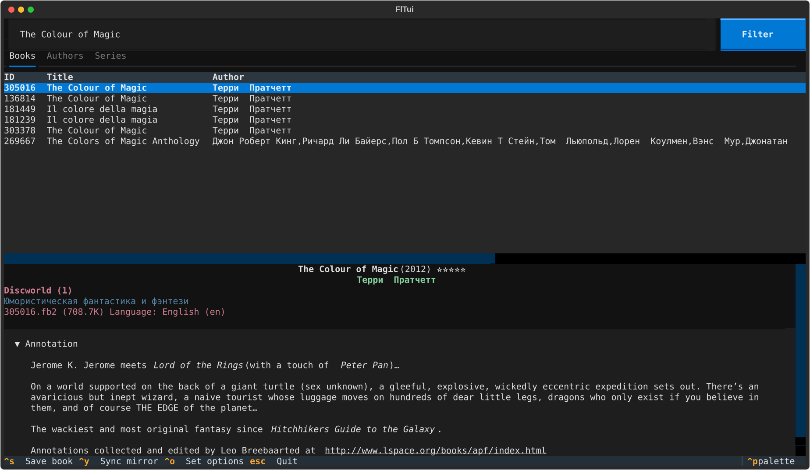
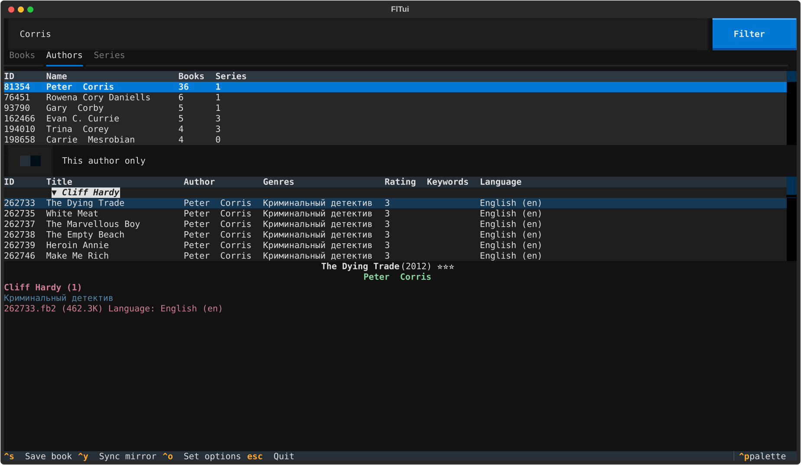
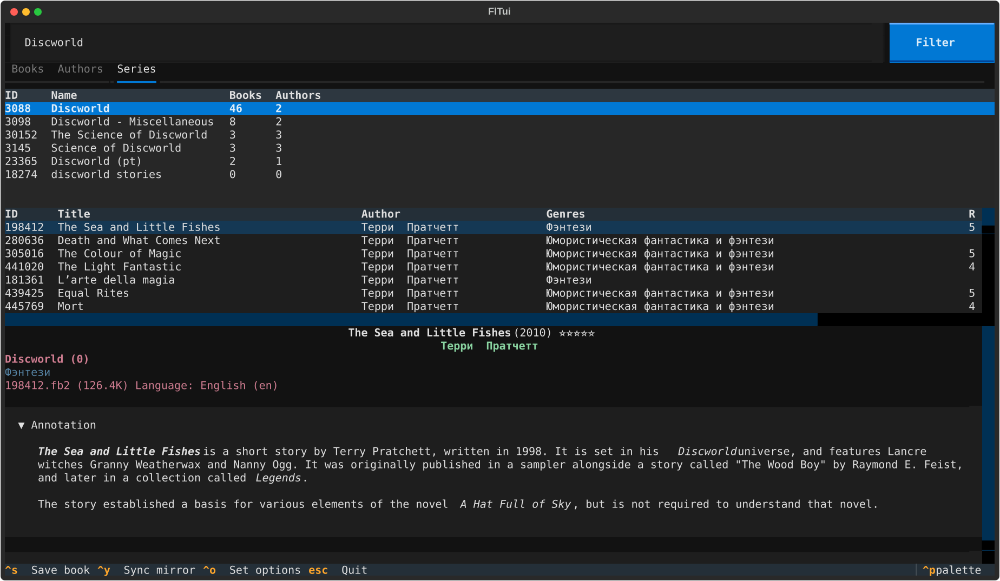
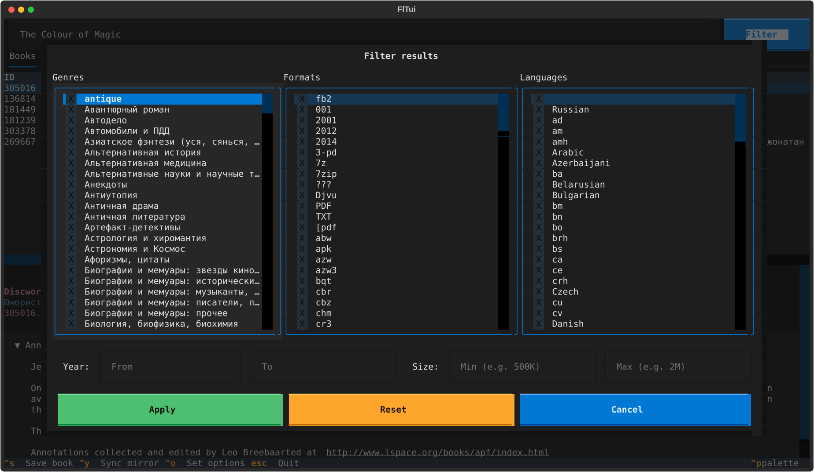
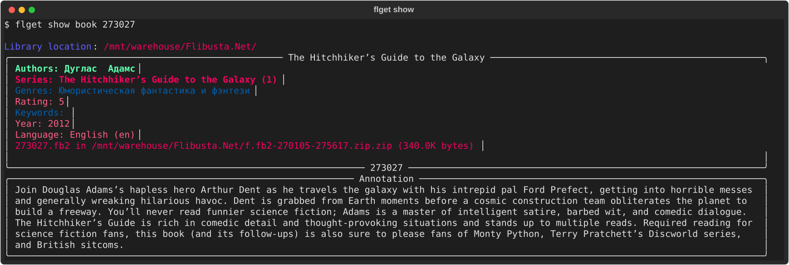
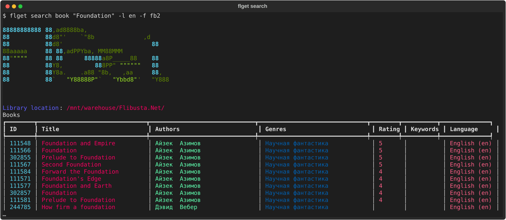

# flget

<p>
  <a href="https://pypi.org/project/flget/"></a>
  <a href="https://pypi.org/project/flget/"></a>
  <a href="https://github.com/akashihi/flget/blob/HEAD/LICENSE"></a>
  <a href="https://github.com/akashihi/flget/commits"></a>
  <a href="https://github.com/akashihi/flget/issues"></a>
  <a href="https://github.com/akashihi/flget/stargazers"></a>
</p>

<p>
  <a href="https://github.com/astral-sh/uv"></a>
  <a href="https://github.com/astral-sh/ruff"></a>
  <a href="https://mypy-lang.org/"></a>
  <a href="https://pre-commit.com/"></a>
  <a href="https://textual.textualize.io/"></a>
</p>

Search and extract books from a local [Flibusta](https://flibusta.is) mirror.

There are two frontends over the same backend:

- `fltui`: a terminal UI with search-as-you-type, author and series
  browsing, filters, and a book card with annotation, reviews and cover.
- `flget`: a CLI for searching, inspecting, syncing and extracting books.



> **⚠️ flget distributes no books and no copyrighted content.** It only indexes and
> reads a library mirror that you already have on your own disk. It is not
> affiliated with Flibusta. See the [Disclaimer](#disclaimer).

## Contents

- [Screenshots](#screenshots)
- [Requirements](#requirements)
- [Installation](#installation)
- [First run](#first-run)
- [Usage](#usage)
- [Sync](#sync)
- [Files](#files)
- [FAQ](#faq)
- [Development](#development)
- [Disclaimer](#disclaimer)
- [License](#license)

## Screenshots

<table>
  <tr>
    <td width="50%">
      
      <p align="center"><sub><b>Authors</b>: an author's books, grouped by series</sub></p>
    </td>
    <td width="50%">
      
      <p align="center"><sub><b>Series</b>: a cycle in reading order</sub></p>
    </td>
  </tr>
  <tr>
    <td width="50%">
      
      <p align="center"><sub><b>Filters</b>: genre, format, language, year and file size</sub></p>
    </td>
    <td width="50%">
      
      <p align="center"><sub><b>CLI</b>: <code>flget show book</code></sub></p>
    </td>
  </tr>
</table>


<p align="center"><sub><b>CLI</b>: <code>flget search book "Foundation" -l en -f fb2</code></sub></p>

## Requirements

- Python 3.12 or newer.
- A local Flibusta mirror.

  ```text
  /mnt/library/Flibusta.Net/
  ├── d.fb2-009373-367300.zip
  ├── d.usr-172703-173908.zip
  ├── f.fb2-173909-177717.zip
  ├── …
  └── flibusta_all_local.inpx
  ```

- Optional: a terminal with an image protocol (Kitty, WezTerm, iTerm2, Sixel)
  for covers. Elsewhere covers are drawn with half-block characters.

## Installation

```bash
uv tool install flget
# or
pipx install flget
```

This installs two commands, `flget` and `fltui`.

From source:

```bash
git clone https://github.com/akashihi/flget.git
cd flget
uv sync
uv run fltui
```

## First run

```bash
flget set-library-path /mnt/library/Flibusta.Net   # stored in flget.toml
flget sync                                         # import the INPX, build the index, validate
fltui
```

The first sync parses the whole catalogue and opens every archive for
validation, so on a full mirror it takes a while. Until a sync has completed,
commands say so instead of returning empty results.

## Usage

### fltui

Type in the search box to search the active tab (Books, Authors or Series).

| Key | Action |
|---|---|
| Filter button | Genre, format, language, year and size filters |
| `Ctrl+S` | Save the highlighted book (default: Documents folder) |
| `Ctrl+P` | Command palette |
| `Esc` | Quit |

The Authors tab lists an author's books grouped by series. The *This author
only* switch hides other authors' books in shared series.

### flget

Search:

```bash
flget search book   "The Colour of Magic"
flget search author "Corris"
flget search series "Discworld"
flget search all    "Foundation"
```

Filters work on every search, can be repeated and combined:

```bash
flget search book "Foundation" -l en -f fb2 -f epub
flget search book "Dune" -l en --year-from 2000 --year-to 2015
flget search book "War and Peace" -l en --min-size 500K --max-size 5M
```

| Option | Meaning |
|---|---|
| `-g`, `--genre CODE` | Genre code |
| `-f`, `--format EXT` | File format: `fb2`, `epub`, `pdf`, … |
| `-l`, `--language CODE` | Language code: `ru`, `en`, … |
| `--year-from`, `--year-to` | Publication year range |
| `--min-size`, `--max-size` | File size range: `500K`, `2M`, `1.5G` |

`flget filters genres|formats|languages` lists the values present in your mirror.

Show details by ID (IDs come from search output):

```bash
flget show book   273027
flget show author 81354
flget show author 81354 --author-only    # only this author's books in shared series
flget show series 3088
```

Extract a book:

```bash
flget get 305016             # into the Documents folder
flget get 305016 ~/Books
```

## Sync

`flget sync` builds the catalogue from one of two sources:

| Source | Speed | Contents |
|---|---|---|
| INPX (default) | fast | titles, authors, series, genres, languages, file info |
| SQL dumps | slow | the above with Flibusta's real IDs, plus annotations, reviews and covers |

The default imports the INPX, then validates it against the archives on disk:
missing archives, unknown archives, and books found in archives but not in the
catalogue. If the INPX turns out incomplete, sync suggests a dump sync.

The INPX has no author or series IDs, so flget assigns its own during import.
Author and series IDs shown by `flget search` and used by `flget show` therefore
differ between an INPX sync and a dump sync; after switching sources, look them
up again.

```bash
flget sync                              # INPX
flget sync --dumps-dir ~/flibusta-sql   # SQL dumps from a local folder
```

flget does not download the dumps itself. `--dumps-dir` takes a flat folder of the dumps under
their original names:

```text
lib.libavtor.sql.gz         lib.libgenrelist.sql.gz     lib.libseq.sql.gz
lib.libavtorname.sql.gz     lib.libjoinedbooks.sql.gz   lib.libtranslator.sql.gz
lib.libbook.sql.gz          lib.librate.sql.gz          lib.b.annotations.sql.gz
lib.libfilename.sql.gz      lib.librecs.sql.gz          lib.b.annotations_pics.sql.gz
lib.libgenre.sql.gz         lib.libseqname.sql.gz       lib.reviews.sql.gz
lib.b.attached.zip
```

## Files

Locations come from [platformdirs](https://github.com/tox-dev/platformdirs):

| | Linux | macOS | Windows |
|---|---|---|---|
| Config (`flget.toml`) | `~/.config/flget/` | `~/Library/Application Support/flget/` | `%LOCALAPPDATA%\flget\flget\` |
| Cache (index, `files.db`, dumps) | `~/.cache/flget/` | `~/Library/Caches/flget/` | `%LOCALAPPDATA%\flget\flget\Cache\` |

The cache is fully rebuildable: delete it and run `flget sync`. The mirror
itself is only ever read.

## FAQ

**Why are author names and genres in Russian?**
That's how the Flibusta catalogue stores them. Translated authors are listed
under the Russian spelling (Terry Pratchett is *Терри Пратчетт*); genre names
are always Russian. Titles keep their original language. If an author search
finds nothing, search by title, series or the Russian name.

**No annotations, reviews or covers.**
The INPX doesn't contain them. Sync from the SQL dumps.

**Covers look blocky.**
The terminal has no image protocol; flget falls back to half-blocks.

## Development

```bash
uv sync
uv run pre-commit install
uv run pre-commit run --all-files   # ruff, mypy --strict, deptry, codespell, gitleaks, pytest
```

Tests cover the pure parsers (INPX, mysqldump, naming, filters) and need no
mirror. Sync, index, CLI and TUI are checked by running them.

## Disclaimer

flget is a search and indexing tool. It does not host, distribute or link to
books or other copyrighted material, and works only with a mirror already on
your storage, which it reads but never modifies. It makes no network access.
It is not affiliated with Flibusta. Make sure your
use of any library complies with the laws of your country.

## License

GPL-3.0-or-later. See [LICENSE](LICENSE).

Denis Chaplygin - Initial work - [akashihi](https://github.com/akashihi)
